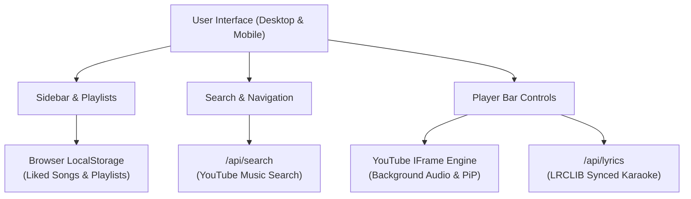

# 🎧 AuraFy — Modern Spotify Web Player (Powered by YouTube Music)

<div align="center">


**An ultra-fast, aesthetic Spotify Web Player clone powered by YouTube Music and synchronized lyrics. Built for 100% free deployment on Vercel.**

[](https://vercel.com/new/clone?repository-url=https://github.com/giri20007/AuraFy)
[](https://github.com/giri20007/AuraFy)
[](LICENSE)

</div>

---

## ✨ Features

- 🎵 **Unlimited YouTube Music Streaming**: Access millions of songs, albums, and artists through YouTube Music's global catalog.
- 🎨 **Authentic Spotify Dark UI**: Pixel-perfect Spotify aesthetic (`#121212`, `#181818`, Spotify Green `#1DB954`) with dynamic hero gradient color adaptation based on current album artwork.
- 🎤 **Synchronized Karaoke Lyrics**: Real-time word/line-by-line synchronized lyrics powered by the LRCLIB open-source database. Click any lyric to jump right to that timestamp!
- 📺 **Canvas / Video Mode Toggle**: Switch effortlessly between minimalist Spotify audio playback and watching the YouTube music video in picture-in-picture or docked video view.
- 💖 **Liked Songs & Custom Playlists**: Save your favorite songs with celebration animations and create, edit, or delete custom playlists saved locally in your browser (`localStorage`).
- 📊 **Animated Audio Visualizer**: Bouncing frequency bars synchronized with active playback.
- 📑 **Dynamic Queue Management**: Reorder, view upcoming tracks, and add songs to the queue on the fly.
- ⚡ **Zero-Cost Free Vercel Deployment**: 100% serverless Next.js App Router architecture requiring $0 in API or database hosting costs.

---

## 🚀 1-Click Free Vercel Deployment

Deploy your own live version of **AuraFy** to Vercel for free in under 2 minutes:

1. Click the **[Deploy with Vercel](https://vercel.com/new/clone?repository-url=https://github.com/giri20007/AuraFy)** button.
2. Select your GitHub account and click **Create**.
3. Vercel will automatically build and deploy the app with global Edge CDN and free SSL!

*Or manually:*
1. Go to [vercel.com/new](https://vercel.com/new).
2. Import the repository `giri20007/AuraFy`.
3. Keep default settings (`Next.js`) and click **Deploy**.

---

## 🛠️ Local Development

### Prerequisites
- Node.js 18.x or 20.x
- npm / yarn / pnpm

### Getting Started

```bash
# 1. Clone the repository
git clone https://github.com/giri20007/AuraFy.git

# 2. Enter project folder
cd AuraFy

# 3. Install dependencies
npm install

# 4. Start the development server
npm run dev
```

Open [http://localhost:3000](http://localhost:3000) in your browser.

---

## 🏗️ Architecture & Tech Stack



- **Framework**: [Next.js](https://nextjs.org/) (App Router & Serverless API Routes)
- **Styling**: [Tailwind CSS v4](https://tailwindcss.com/)
- **Icons**: [Lucide React](https://lucide.dev/)
- **Audio Engine**: YouTube IFrame Player API
- **Lyrics Database**: [LRCLIB](https://lrclib.net/)
- **Confetti**: Canvas Confetti

---

## 📄 License

This project is open-source under the [MIT License](LICENSE).
